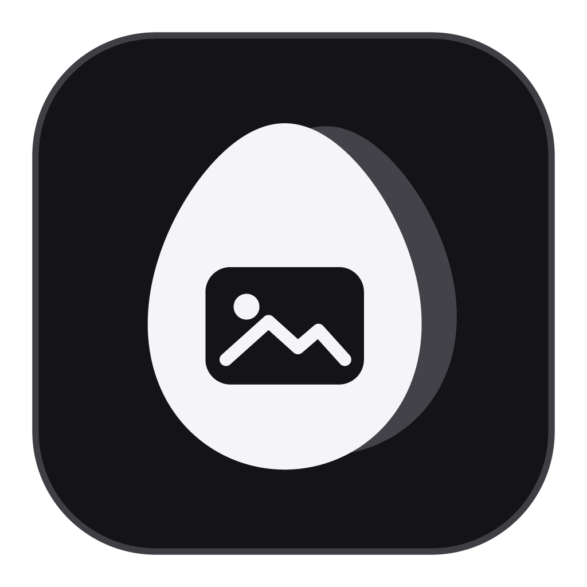
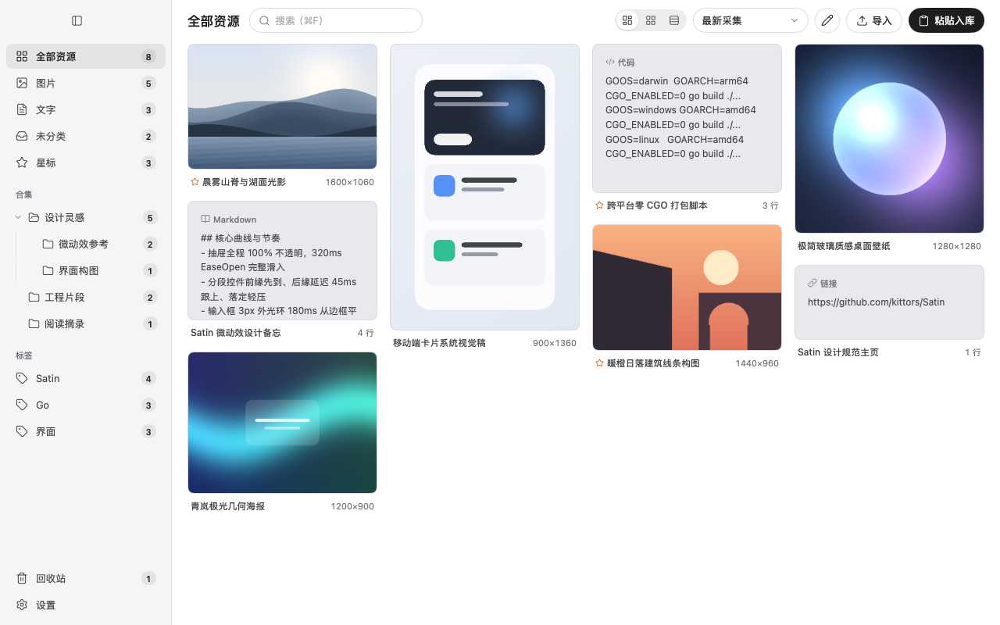
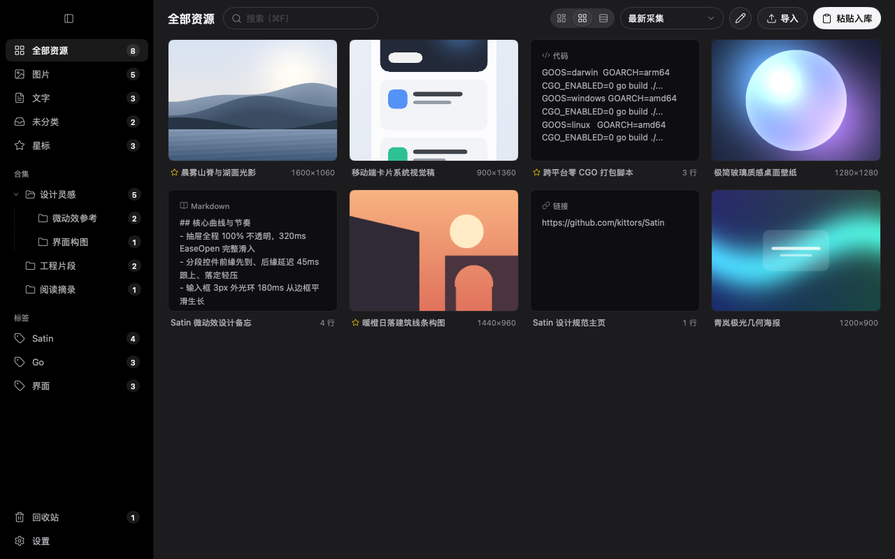
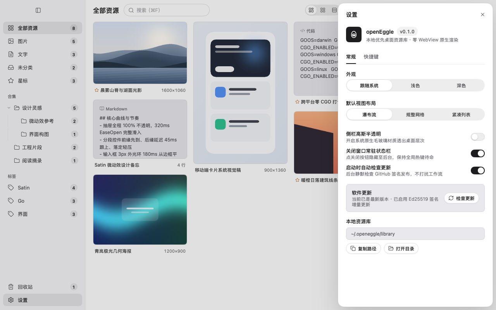
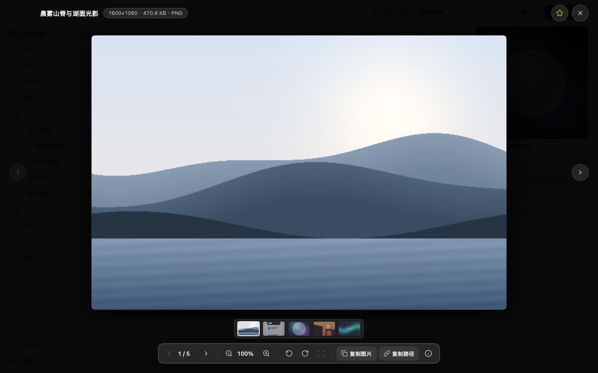

# openEggle

**轻量级、本地优先、原生 GPU 渲染的跨平台桌面数字资产与存储治理工具**

**零 WebView · 零 CGO · 100% 本地离线计算 · Satin 原生设计与物理微动效**

> 本仓库为 **openEggle** 的官方发布、在线更新与问题反馈仓库（应用本体为闭源分发）。

---

## 为什么选择 openEggle？

日常研发、设计与写作中，我们频繁截取参考图、收纳音视频与 PDF/Office 文档、沉淀代码片段与网页链接，还经常把大体积原图直接发给 AI 助手或聊天软件。传统工具往往依赖沉重的 Electron/WebView，或强绑定云端账号。

**openEggle** 回归原生桌面工具的纯粹体验：
- **100% 本地优先与离线计算**：图片、音视频、文档、文本与任意文件全部沉淀到本地目录（默认 `~/.openeggle/library`，无空格路径），离线 OCR、视觉搜索、相似图清理、系统重复副本扫描均在本地完成；对象存储按需开启（默认关闭）。
- **复制即入库，全局浮窗无冲突速取**：任意应用下按 **`⌘⇧E` / `Ctrl+Shift+E`** 秒弹原生毛玻璃速取浮窗（不切走原窗口）：直接按 `⌘V` 立即把文字/截图/文件存入库中，直接打字即秒搜（支持粘贴绝对路径/URL 直搜），单击或按 `⌘C` 即刻复制并收起。
- **本地硬件加速图片智能压缩（发 AI 极速省流）**：可选开启本地硬件图片压缩（Apple Silicon GPU / ImageIO 硬件管线与多核引擎），默认完整保留无损原图，复制与粘贴自动输出画质锐利的轻量化高清图（体积直降 80%~94%，显著降低给 AI 发送原图时的带宽占用与 base64 耗时），右键随时一键获取原图。
- **全品类沉浸预览与原生 GPU 微动效**：原生 Metal / Direct3D 11 / OpenGL 渲染，支持共享元素大图看图器、Satin 原生音视频播放器、PDF/Office/Markdown 预览，以及内置标准本地 MCP Server 供 AI 检索与引用本地资产。

---

## 产品预览

### 浅色外观 · 瀑布流与树形合集

### 深色外观 · 卡片视图

<table>
  <tr>
    <td width="50%">
      <strong>悬浮大圆角设置抽屉与在线更新</strong>  
      
    </td>
    <td width="50%">
      <strong>沉浸式无闪白大图看图器</strong>  
      
    </td>
  </tr>
</table>

---

## 快捷键速查

| 功能 | macOS | Windows / Linux |
| :--- | :--- | :--- |
| 任意窗口呼出全局速取浮窗 | `⌘ ⇧ E` | `Ctrl + Shift + E` |
| 全局后台快采剪贴板 | `⌘ ⇧ V` | `Ctrl + Shift + V` |
| 窗口内 / 速取浮窗粘贴入库 | `⌘ V` | `Ctrl + V` |
| 悬停或选中卡片极速复制 | `⌘ C` / `Ctrl + C` | `Ctrl + C` |
| 悬停或选中复制绝对路径 | `⌘ ⇧ C` / `Ctrl + Shift + C` | `Ctrl + Shift + C` |
| 鼠标悬停快速预览 / 关闭 | `Space` / `Esc` | `Space` / `Esc` |
| 聚焦搜索（支持关键词与路径/URL） | `⌘ F` | `Ctrl + F` |
| 新建文本卡片 | `⌘ N` | `Ctrl + N` |
| 切换瀑布流 / 卡片视图 / 紧凑列表 | `⌘ 1` / `⌘ 2` / `⌘ 3` | `Ctrl + 1` / `2` / `3` |
| 收起或展开侧栏 | `⌘ \` | `Ctrl + \` |

---

## 下载安装与在线更新

前往 [GitHub Releases](https://github.com/kittors/openEggle/releases/latest) 下载对应平台安装包：

- **macOS (Apple Silicon / Intel)**：下载 `.dmg`，将 `openEggle.app` 拖入「应用程序」文件夹。
- **Windows (x64)**：下载 `-setup-*-amd64.exe` 安装程序运行即可。
- **Linux (x64)**：下载 `.tar.gz` / `.deb` / `.rpm` 或运行发布包附带的 `install.sh`。

### 在线更新
正式版默认开启启动静默检查更新，也可以在左下角 **设置 → 检查更新** 或状态栏菜单随时触发。所有更新包均经 Ed25519 私钥签名，客户端验证通过后以增量补丁自动完成替换与重启。

---

## 反馈与支持

如遇问题或有功能建议，欢迎在本仓库提交 [Issue](https://github.com/kittors/openEggle/issues)。版本更新日志见 [CHANGELOG.md](CHANGELOG.md)。
